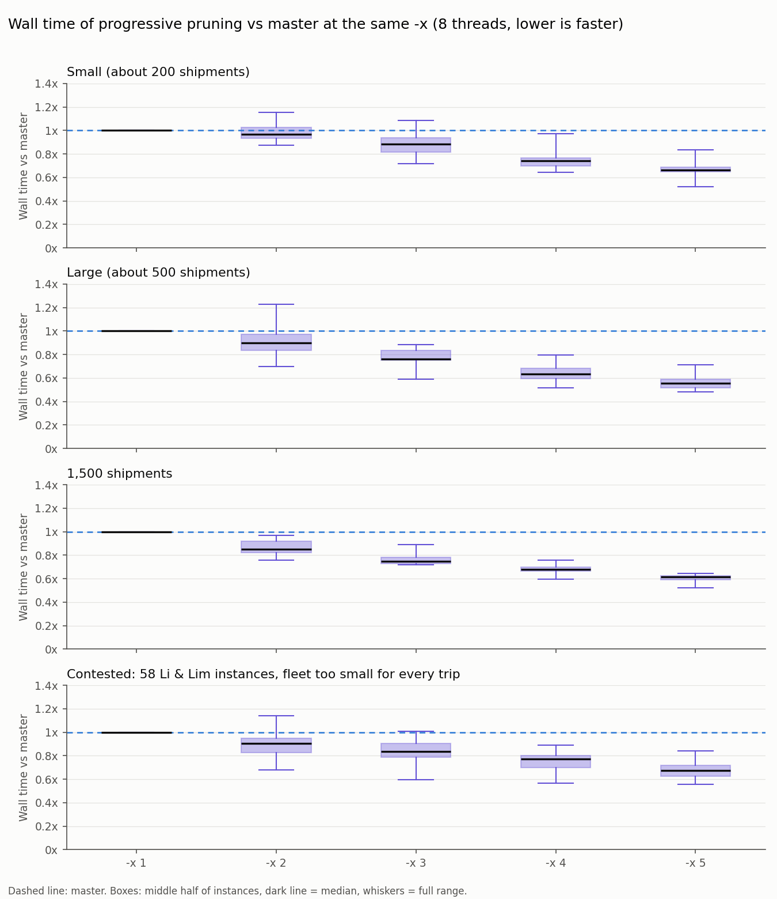
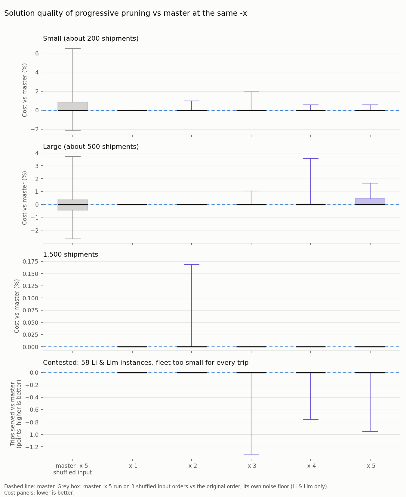
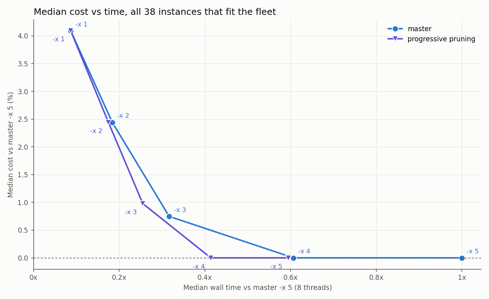

# Progressive pruning vs master

With progressive pruning, every search still builds its heuristic solution and runs the first descent. After that, the searches deepen together, and after each depth they complete only the best ones carry on:

| `-x` | Searches | Depth | Searches kept after the descent, then after each deepening step |
|---|---|---|---|
| 1 | 8 | 1 | 8 (nothing to cut: master's code path) |
| 2 | 12 | 2 | 12, 9 |
| 3 | 16 | 3 | 16, 12, 8 |
| 4 | 24 | 4 | 24, 18, 12, 9 |
| 5 | 32 | 5 | 32, 24, 16, 12, 8 |

"Best" uses the existing solution comparison: priority served, then tasks assigned, then cost, and so on. Threads that would otherwise wait for a cut keep advancing the best-ranked searches, and a search cut while running is stopped. The cuts only look at each search's own score at that depth, so the thread count matters no more than on master: only through which of two heuristic solutions with equal scores is seen first. Runs with a timeout (`-l`), `-x 0` and `-x 1` take the existing code path unchanged.

## Setup

- **Instances:** public data only.
  - Li & Lim PDPTW: 12 instances with about 200 shipments and 18 with about 500.
  - Sartori & Buriol PDPTW: 8 instances with 1,500 shipments on city road networks.
  - A contested set: 58 Li & Lim instances whose fleet was cut until not every trip fits.
- **Hardware:** AMD Ryzen 9 9950X, 8 threads pinned to the physical cores of one CCD, one job per machine at a time.
- **Comparison:** each instance is compared with master at the same `-x`. Master `-x 5` median solving time is 1.3 s on the small instances, 19.7 s on the large ones, 187 s at 1,500 shipments and 3.5 s on the contested set.

## Time

At `-x 3` to `-x 5` the gain grows with the level, reaching 0.55x to 0.67x at `-x 5`. At `-x 2` it is 0.85x to 0.97x. `-x 1` has nothing to cut and runs master's code path.

## Quality

Pruning can only drop searches master would have kept, so apart from exact ties a solution is never better than master's. On most instances it is identical. Where it differs, the difference is small compared with master's own run-to-run variation: the grey box shows master `-x 5` on three shuffled input orders of the same instances.

| Instances | -x | Wall time vs master (median) | Mean cost change | Instances changed | Instances above +0.5% |
|---|---|---|---|---|---|
| Small (about 200 shipments) | 1 | 1.00x | +0.00% | 0 of 12 | 0 |
| Small (about 200 shipments) | 2 | 0.97x | +0.08% | 1 of 12 | 1 |
| Small (about 200 shipments) | 3 | 0.88x | +0.16% | 1 of 12 | 1 |
| Small (about 200 shipments) | 4 | 0.74x | +0.09% | 2 of 12 | 1 |
| Small (about 200 shipments) | 5 | 0.66x | +0.05% | 1 of 12 | 1 |
| Large (about 500 shipments) | 1 | 1.00x | +0.00% | 0 of 18 | 0 |
| Large (about 500 shipments) | 2 | 0.90x | +0.00% | 0 of 18 | 0 |
| Large (about 500 shipments) | 3 | 0.76x | +0.12% | 3 of 18 | 2 |
| Large (about 500 shipments) | 4 | 0.63x | +0.35% | 5 of 18 | 3 |
| Large (about 500 shipments) | 5 | 0.55x | +0.24% | 6 of 18 | 5 |
| 1,500 shipments | 1 | 1.00x | +0.00% | 0 of 8 | 0 |
| 1,500 shipments | 2 | 0.85x | +0.02% | 1 of 8 | 0 |
| 1,500 shipments | 3 | 0.75x | +0.00% | 0 of 8 | 0 |
| 1,500 shipments | 4 | 0.68x | +0.00% | 0 of 8 | 0 |
| 1,500 shipments | 5 | 0.62x | +0.00% | 0 of 8 | 0 |

Master's own variation, `-x 5` on 3 shuffled input orders vs the original order:

| Instances | Mean | Standard deviation | Range |
|---|---|---|---|
| Small (about 200 shipments) | +0.70% | 2.02% | −2.17% to +6.48% |
| Large (about 500 shipments) | +0.01% | 1.17% | −2.67% to +3.72% |

### When not every trip fits (contested fleet)

| -x | Wall time vs master (median) | Trips served vs master (total) | Instances with fewer trips | Share of all 29,869 trips |
|---|---|---|---|---|
| 1 | 1.00x | +0 | 0 of 58 | 0% |
| 2 | 0.91x | +0 | 0 of 58 | 0% |
| 3 | 0.84x | −24 | 6 of 58 | −0.08% |
| 4 | 0.77x | −9 | 5 of 58 | −0.03% |
| 5 | 0.67x | −19 | 9 of 58 | −0.06% |

## Time vs quality

Taken across levels, progressive pruning traces a curve below master's from `-x 2` on. At `-x 4` it reaches master `-x 5`'s median cost in about 0.42x of master `-x 5`'s time.

## Checks on this branch

Run on this branch against a master build, on the same machine:

| Check | Result |
|---|---|
| Same solutions as the measured prototype runs (20 instances x `-x 1` to `-x 5`) | 99 of 100 identical. LC2_10_2 (contested) at `-x 3` differs and serves 1 more trip: a paused search resumes from its best solution, where the prototype carried on from a current solution with exactly equal score. |
| Same solution at 1, 2, 4, 8 and 16 threads (7 instances, `-x 5`) | identical on all 7 |
| `-l 2` (timeout path) and `-x 0` | run as on master; `-x 0` gives the same solution |
| Peak memory at `-x 5`, 8 threads | 0.86x to 0.89x of master (1,500 shipments: 1.89 GB vs 2.13 GB) |
| Solving time at `-x 5`, 8 threads, same cost as master | 0.47x to 0.62x of master on 4 instances |

Between cuts, a paused search keeps only its best solution and the depth it completed, so at most one local search per thread is held in memory. Master's behaviour is the same, which is why peak memory does not grow.

Master itself can return two different solutions with equal cost depending on thread count (LC1_4_1 at `-t 16`), when two heuristics produce different plans with the same score. That tie is untouched by this change.

The numbers above come from the measured runs of the prototype this branch was cleaned up from, with `-x 1` taken as master since it now runs master's code. Check 1 above shows that the branch reproduces them.
