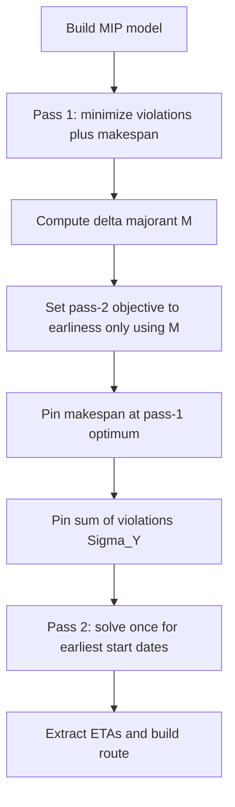
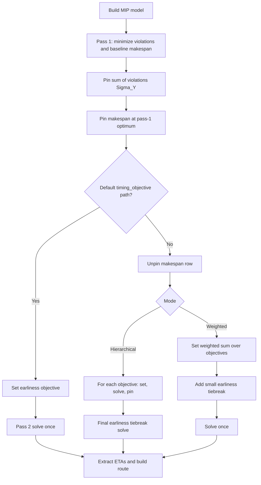

# Timing Objective Flows

This document summarizes:

- old flow: `master` branch behavior
- new flow: current `feature/timing-objective` branch behavior

## Old Flow (master branch)

## New Flow (current feature branch implementation)

## Notes

- The old `master` flow has a fixed second pass: earliness minimization with pinned makespan and pinned violations.
- The new flow keeps that default path and ignores `target_time` when `timing_objective` is default.
- The new flow also adds a configurable branch for hierarchical and weighted timing objectives.
- In the configurable branch, makespan is explicitly unpinned before applying user objectives.
